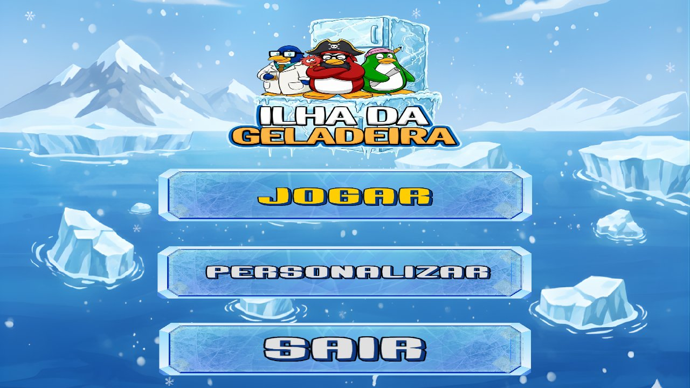
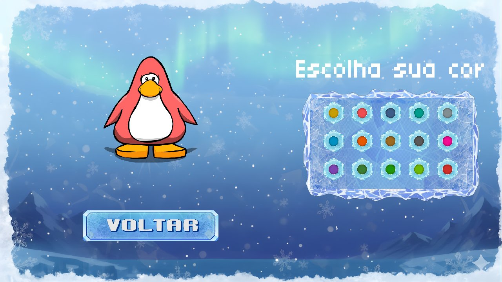
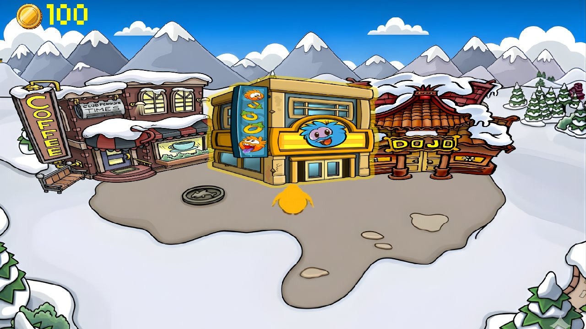
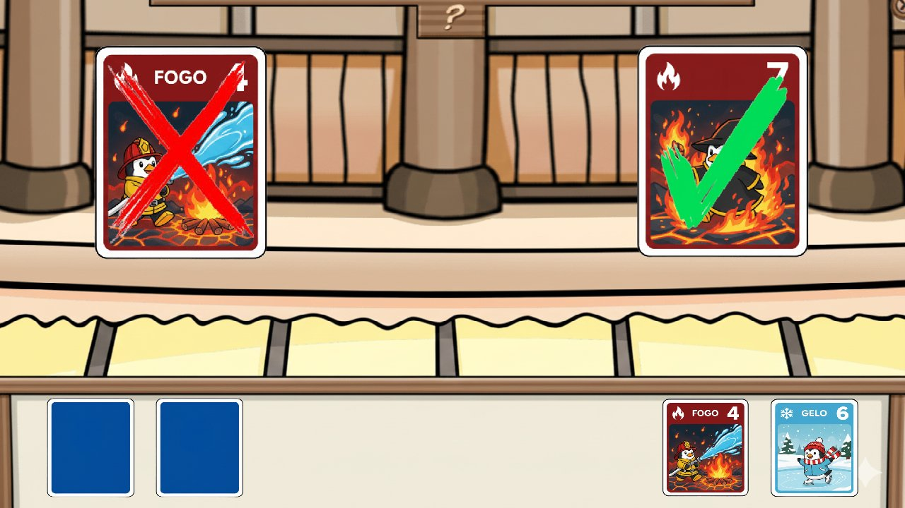
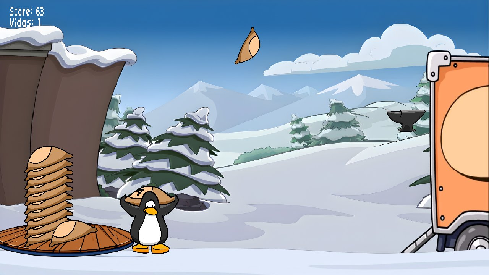
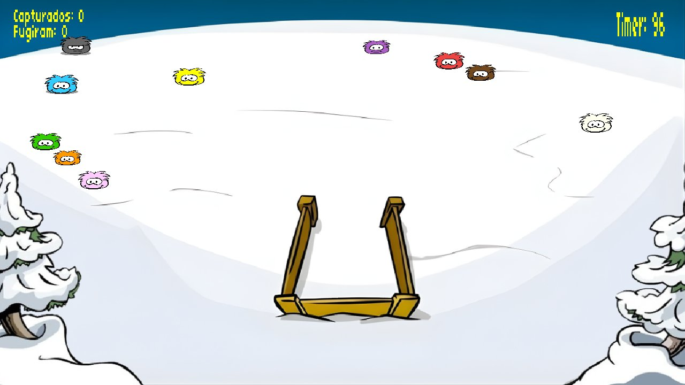

# ❄️ Ilha Geladeira

Jogo 2D de pinguins com três minigames, escrito duas vezes, com o mesmo
comportamento quadro a quadro:

- em **Lua**, no estilo imperativo com orientação a objetos: um laço de jogo
  que, a cada quadro, avança o tempo, trata a entrada e desenha;
- em **[Atmos](https://github.com/atmos-lang/atmos)**, com concorrência
  estruturada síncrona: tasks, `await`, `par`, `watching` e eventos.

É o projeto prático do TCC *Desenvolvimento de Jogos: Uma Análise Comparativa
entre Orientação a Objetos e Concorrência Estruturada* (UERJ, 2026), sob
orientação de Francisco Sant'Anna. As duas versões usam o
[pico-sdl](https://github.com/fsantanna/pico-sdl) para desenho e entrada, e
um teste de replay determinístico confirma que elas fazem exatamente a mesma
coisa ([`docs/EQUIVALENCIA.md`](docs/EQUIVALENCIA.md)).



## O jogo

### Menu e personalização

O menu leva à praça (**Jogar**), à escolha da cor do pinguim
(**Personalizar**) ou fecha o jogo (**Sair**). Na personalização, clique numa
cor do quadro de gelo; a cor vale também na praça.



### Praça (centro)

Clique no chão para o pinguim andar até lá. Clique num prédio para entrar
nele: o pinguim caminha até a porta e o minigame começa. Ao fim de cada
minigame, as moedas ganhas aparecem no canto. **Escape** volta ao menu, da
praça ou de dentro de um minigame.

| Prédio | Minigame |
|---|---|
| Coffee (cafeteria) | Bean Counters |
| Pet shop | Pega Puffles |
| Dojo | Dojo (cartas) |



### Dojo

Três rodadas de cartas contra o inimigo. Clique numa carta da sua mão (à
direita); o inimigo joga uma ao acaso. Fogo vence gelo, gelo vence água e água
vence fogo (o baralho atual tem cartas de fogo e de gelo); com o mesmo
elemento, vence o número maior. Quem vencer mais
rodadas ganha 100 moedas; empate vale 50.



### Bean Counters

O caminhão lança sacos de café e objetos. Ande com **←** e **→**: pegue os
sacos de café (até 5 de uma vez; quanto mais carga, mais devagar) e leve-os à
plataforma, à esquerda. Pegar vale 2 pontos e entregar vale 3. Um objeto, ou
um café com o pinguim já cheio, derruba o pinguim e tira uma vida. O jogo
acaba quando as duas pilhas enchem ou as três vidas acabam, e o placar vira
moedas.



### Pega Puffles

Os puffles fogem do mouse. Use o mouse para empurrá-los para dentro do
cercado em 100 segundos; quem sai do mapa foge. Cada puffle capturado vale 10
moedas.



## Como rodar

### Requisitos

- Lua 5.4 (`lua5.4`) e [LuaRocks](https://luarocks.org);
- SDL2 com as extensões gfx, image, mixer e ttf;
- [pico-sdl](https://github.com/fsantanna/pico-sdl) (binding Lua `pico-lua`),
  versão de desenvolvimento;
- [Atmos](https://github.com/atmos-lang/atmos) (`atmos-lang`), versão de
  desenvolvimento, só para a versão Atmos.

No Ubuntu/Debian:

```bash
sudo apt install lua5.4 liblua5.4-dev luarocks libsdl2-dev libsdl2-gfx-dev libsdl2-image-dev libsdl2-mixer-dev libsdl2-ttf-dev
```

```bash
sudo luarocks --lua-version=5.4 install --dev pico-sdl
```

```bash
sudo luarocks --lua-version=5.4 install --dev atmos-lang
```

O projeto foi testado com Lua 5.4.6, `pico-sdl dev-2` e `atmos-lang dev-4`
(CLI `atmos v0.8`, runtime `atmos dev-3`).

### Versão Lua

```bash
cd src/lua && lua main.lua
```

(ou `pico-lua main.lua`)

### Versão Atmos

```bash
cd src/atmos && atmos main.atm
```

Rode cada versão de dentro da sua pasta: as imagens são carregadas por
caminhos relativos (`../../assets`).

## Estrutura

```
src/
  lua/        versão Lua: main.lua, jogo.lua, screens/ (telas e minigames), util/
  atmos/      versão Atmos: main.atm, screens/ (telas e minigames), util/
assets/       imagens do jogo, compartilhadas pelas duas versões
tests/equiv/  teste de equivalência por replay determinístico (Lua x Atmos)
tools/        metricas.py: métricas de comparação entre as duas versões
docs/         ANALISE_TCC.md, EQUIVALENCIA.md, PADROES.md e as capturas de tela
```

| Tela | Lua (`src/lua/`) | Atmos (`src/atmos/`) |
|---|---|---|
| fluxo de telas | `main.lua`, `jogo.lua` | `main.atm` |
| menu | `screens/telas_menu/menu.lua` | `screens/telas_menu/menu.atm` |
| personalização | `screens/telas_menu/personalizacao.lua` | `screens/telas_menu/personalizar.atm` |
| praça | `screens/centro/` | `screens/centro/` |
| Dojo | `screens/minigames/dojo/` | `screens/minigames/dojo/` |
| Bean Counters | `screens/minigames/bean_counters/` | `screens/minigames/bean_counters/` |
| Pega Puffles | `screens/minigames/pega_puffles/` | `screens/minigames/pega_puffles/` |

## Teste de equivalência

O teste roda as duas versões sem janela (driver `offscreen` do SDL), com o
mesmo roteiro de entradas, relógio virtual e semente fixa, e compara o que
cada uma desenha em cada quadro:

```bash
sh tests/equiv/run.sh tests/equiv/roteiros/fluxo.txt
```

```bash
for r in tests/equiv/roteiros/*.txt; do sh tests/equiv/run.sh "$r" "" 0 | grep -E '^(==|RESUMO)'; done
```

Hoje todos os roteiros dão todos os quadros iguais. O método, os roteiros e
as divergências encontradas (e corrigidas) estão em
[`docs/EQUIVALENCIA.md`](docs/EQUIVALENCIA.md).

## Métricas

```bash
python3 tools/metricas.py
```

Mede, por tela, linhas de código, funções e tasks, condicionais, estado
mutável e as construções de concorrência do Atmos. A análise está na parte 3
de [`docs/ANALISE_TCC.md`](docs/ANALISE_TCC.md).

## Documentos

- [`docs/ANALISE_TCC.md`](docs/ANALISE_TCC.md): validação de referências,
  plano de leitura e de estrutura do texto, inventário e métricas do projeto.
- [`docs/EQUIVALENCIA.md`](docs/EQUIVALENCIA.md): o teste de equivalência
  entre as versões Lua e Atmos.
- [`docs/PADROES.md`](docs/PADROES.md): padrões de jogos (Nystrom; estudo do
  Pingus em Céu) no código, com diagramas das duas versões.

## Licença

[MIT](LICENSE).
