# Padrões de jogos no código da Ilha Geladeira

Padrões de *Game Programming Patterns* (NYSTROM, 2014) e do estudo
*Structured Synchronous Reactive Programming for Game Development — Case
Study: On Rewriting Pingus from C++ to Céu* (SANT'ANNA, SBGames 2018) que
aparecem no código, com exemplos nas duas versões e diagramas para os
capítulos de implementação e de resultados.

Caminhos relativos a `src/lua/` e `src/atmos/`. Estado do código em
24/11/2026.

## Como ler os diagramas

- **Atmos, máquina de estados da task**: cada estado é um ponto em que a task
  está suspensa (um `await`, um `watching` ou um laço `loop ... on`); as
  setas são os eventos que a fazem andar. O estado não fica em nenhuma
  variável: é a posição no código.
- **Atmos, comunicação**: caixas são tasks; setas são eventos (`emit`), com o
  alvo do `emit`. `clock`, `draw` e os eventos de entrada vêm do ambiente
  (`ambiente.lua`) e chegam a todas as tasks.
- **Lua, fluxo**: caixas são funções (métodos); setas são chamadas, na ordem
  em que acontecem dentro do quadro; losangos são testes sobre campos do
  objeto, que é onde o estado fica.

## Resumo

| Padrão | Fonte | Lua | Atmos | Onde entra no texto |
|---|---|---|---|---|
| Game Loop | Nystrom | `main.lua`: `tempo`, `evento`, `desenha` | `ambiente.lua`: emite tempo, entrada e `draw` | 4.2 e 4.3 (as duas arquiteturas) |
| Update Method + Dispatching Hierarchies | Nystrom + Pingus | cada objeto repassa `tempo`/`desenha` aos filhos | a árvore de tasks recebe o `emit` sem repasse | 5 (hierarquia de despacho) |
| State / Finite State Machines | Nystrom + Pingus | campos (`espera`, `tonto`, `bloqueio`, `ponto`) testados a cada quadro | posição no código (`await`, `watching`, `toggle`) | 5 (exemplo principal) |
| Continuation Passing | Pingus | o minigame devolve as moedas por `tempo()`; o `Centro` decide o passo seguinte | `moedas += await Minigame()`: a continuação é a linha seguinte | 5 |
| Lifespan Hierarchies | Pingus | campos `viva`, `lista.tira_mortos`, `self.minigame = nil` | tasks filhas morrem com a mãe (Escape aborta o minigame); pools | 5 |
| Signaling Mechanisms / Observer | Pingus + Nystrom | métodos de observador (`ao_coletar`...) | `emit`/`await` (`:pinguim.coleta`, `:pilha.cheia`) | 5 |
| Component | Nystrom | herança: `Predio` estende `Botao` | composição: `Image`, `Image_Hover`, `XClickable`, `XCollidable` | 4.3 e 5 |
| Subclass Sandbox | Nystrom | `Objeto` dá `tempo`/`evento`/`desenha` às subclasses | — (tasks no lugar de classes) | 4.2 |
| Type Object | Nystrom | `TIPOS`, `BARALHO`, `IMG_ATINGIDO` | `tipos`, `cartas`, `VENCE` | 4 (dados das regras) |
| Flyweight | Nystrom | um layer por imagem, compartilhado pelas cargas | idem | 4 (e o efeito colateral do giro) |
| Object Pool (relacionado) | Nystrom | listas `cargas`, `puffles` | `tasks(n)`: pools com limite e tempo de vida | 3 (pools do Atmos) |

Não aparecem: Command, Event Queue (o `emit` do Atmos é síncrono, não uma
fila), Spatial Partition (o empurrão dos puffles compara todos com todos),
Double Buffer (feito pelo pico-sdl: `clear`, desenhos, `present`), Bytecode,
Service Locator, Data Locality, Dirty Flag. Vale citar no texto que a
ausência é coerente com o tamanho do jogo.

---

## 1. Game Loop (Nystrom)

O laço de jogo separa o tempo do jogo do tempo real e repete: processar
entrada, atualizar, desenhar. As duas versões fazem o mesmo passo, na mesma
ordem, e usam o tempo real entre passos (`pico.get.now`).

- Lua: `main.lua:24` (o `while`), com `jogo:tempo(dt)`, `jogo:evento(e)` e
  `jogo:desenha()`.
- Atmos: `ambiente.lua:24` (`M.step`), que emite o tempo, o evento e `draw`;
  quem reage são as tasks.

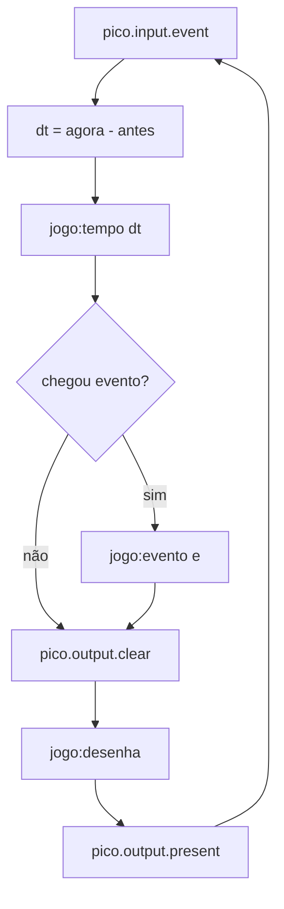

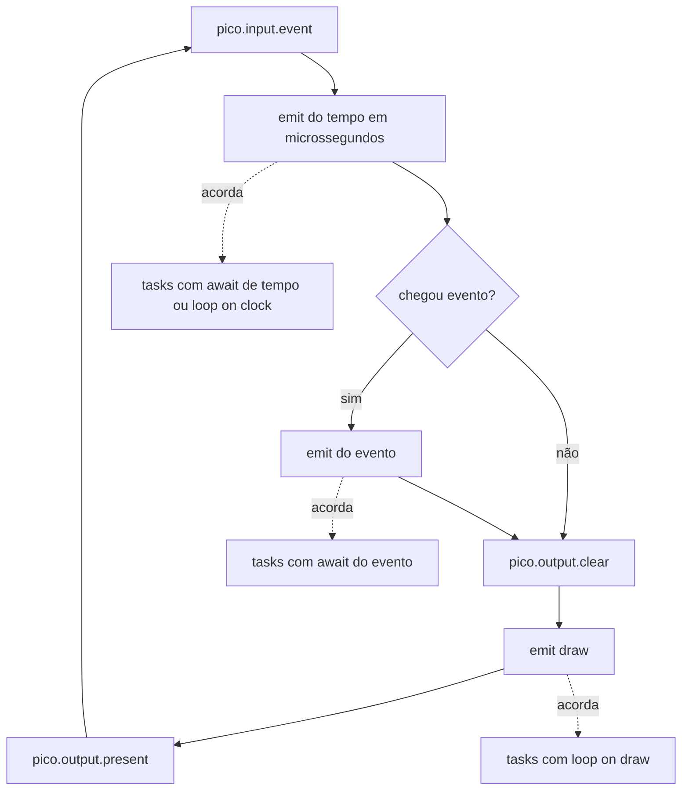

No texto: no Lua o laço *chama* os objetos; no Atmos o laço só *emite*, e
cada task diz o que espera.

## 2. Update Method (Nystrom) e Dispatching Hierarchies (Pingus)

Cada entidade sabe se atualizar e se desenhar; um contêiner repassa o
estímulo aos filhos. No Pingus, a cadeia de despacho (`update` e `draw`
descendo pela hierarquia) é um dos cinco padrões: em Céu ela some, porque o
evento chega a todos.

- Lua: `Jogo:tempo` (`jogo.lua:46`) → `Centro:tempo` (`centro.lua:53`) →
  `BeanCounters:tempo` (`bean_counters.lua:65`) → `Carga:tempo`,
  `Pinguim:tempo`. O mesmo para `desenha`. Cada nível precisa repassar, e a
  ordem do repasse é a ordem da atualização.
- Atmos: nenhum repasse. O `emit` percorre a árvore de tasks na ordem do
  código; uma task nova entra no despacho só por existir.

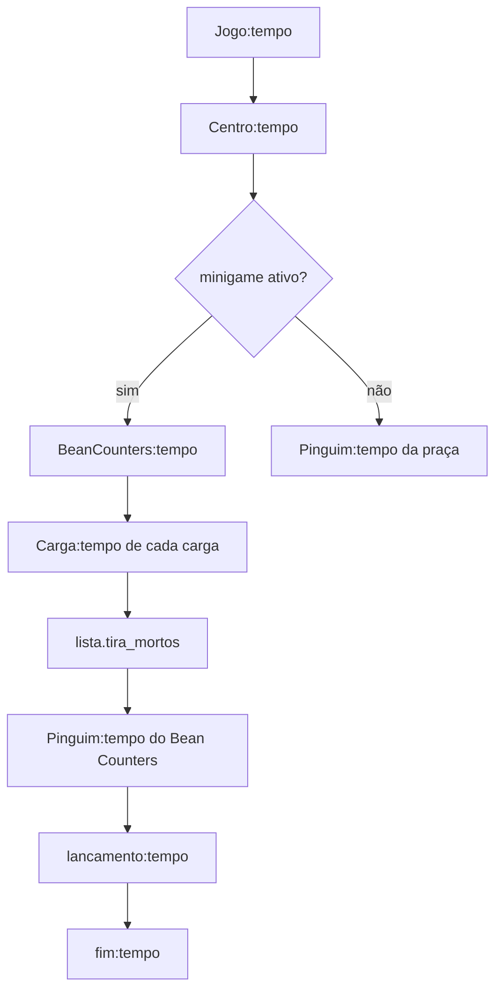

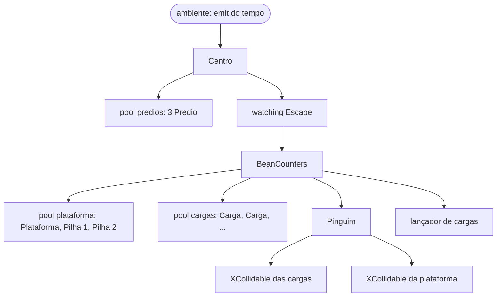

## 3. State (Nystrom) e Finite State Machines (Pingus)

Nystrom propõe trocar flags espalhadas por uma máquina de estados explícita.
O Pingus mostra o passo seguinte: com `await`, a máquina de estados vira
código sequencial e as variáveis de estado somem. As cinco subseções abaixo
são as linhas da tabela 6.3 do `ANALISE_TCC.md`.

### 3.1 Dojo: a rodada

- Atmos: `screens/minigames/dojo/dojo.atm:33-55` (laço das rodadas) e
  `carta.atm:22-33` (carta na mão, depois no campo).
- Lua: `dojo.lua:76` (`evento`), `:63` (`joga`), `:88` (`tempo`);
  `carta.lua:48` (`joga`), `:53` (`tempo`). Estado: `espera`, `rodada`,
  `resultado`, `prazo`, `viva`.

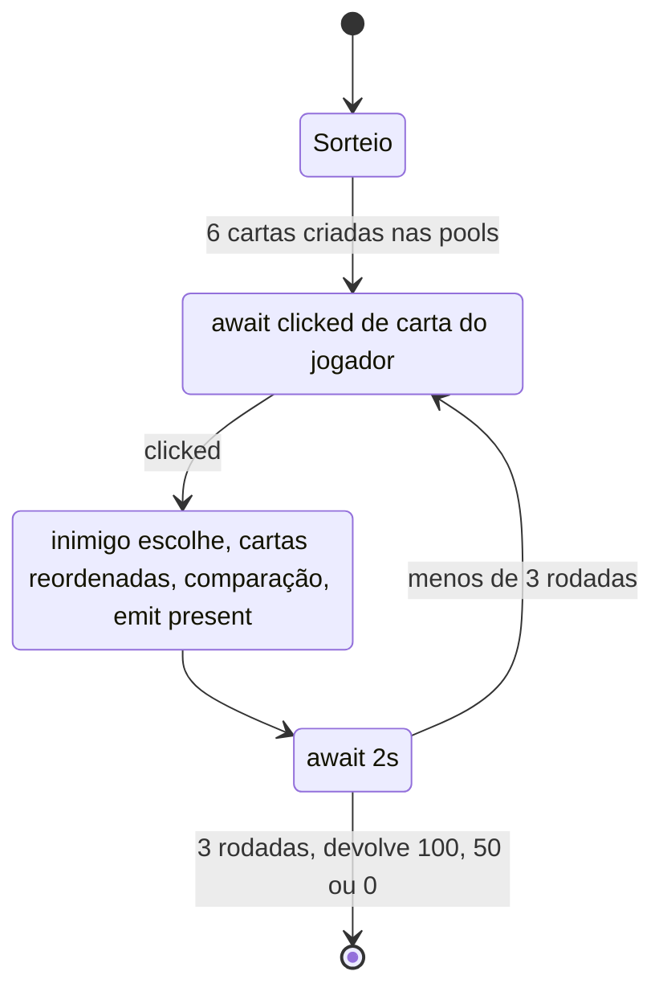

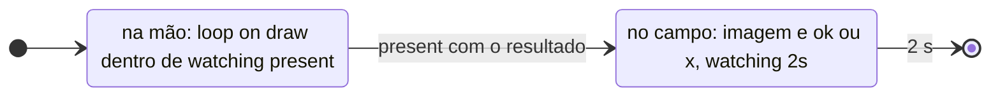

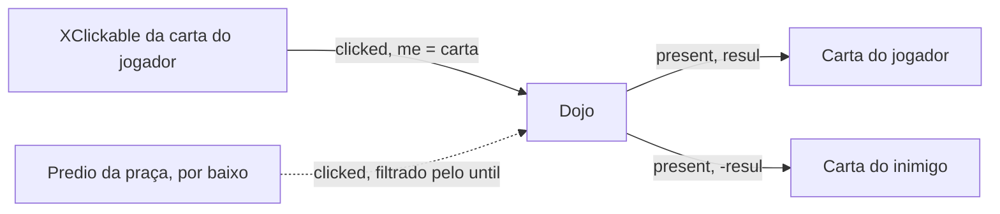

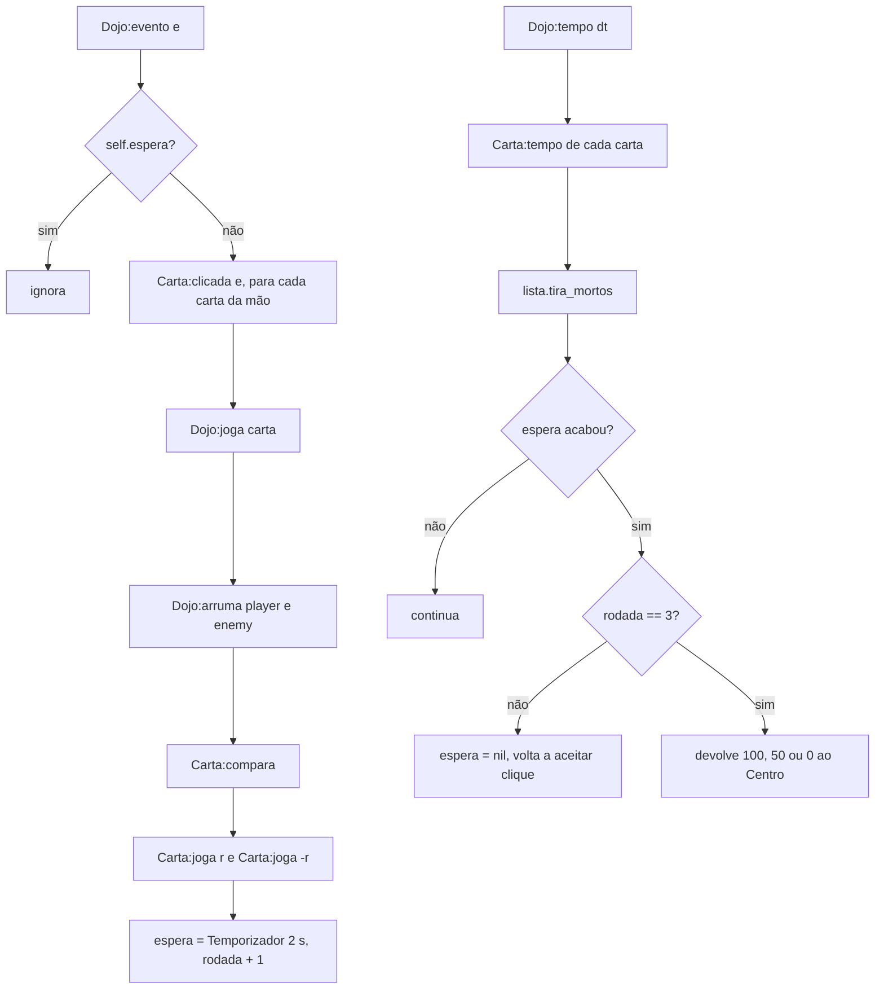

### 3.2 Bean Counters: pinguim atordoado

- Atmos: `bean_counters/pinguim.atm:47-71` (colisões), `:91-105`
  (movimento); `bean_counters.atm:50-62` (lançador). Três tasks reagem ao
  mesmo evento `:pinguim.atordoado`, cada uma com o seu `await 2s`.
- Lua: `pinguim.lua:53` (`pega`), `:82` (`tempo`, com o campo `tonto`);
  `bean_counters.lua:45` (`ao_ser_atingido`, que troca `lancamento`).

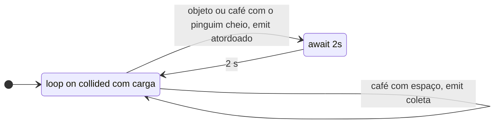

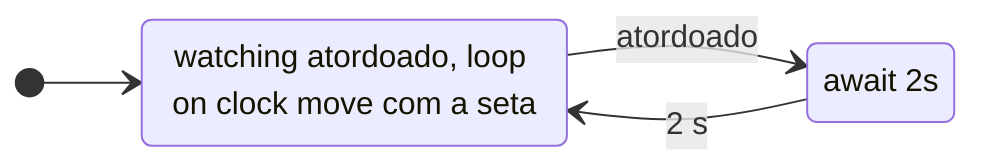

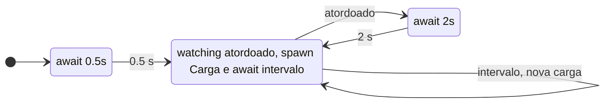

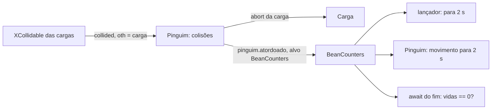

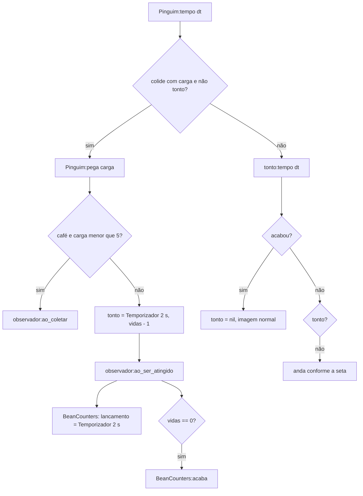

### 3.3 Bean Counters: intervalo da plataforma

- Atmos: `bean_counters/pinguim.atm:27-43` (entrega e `toggle`),
  `plataforma.atm`, `pilha.atm`.
- Lua: `pinguim.lua:47` (`bloqueia_plataforma`), `:71` (`entrega`);
  `plataforma.lua:14` (`recebe`); `bean_counters.lua:39` (`ao_entregar`).

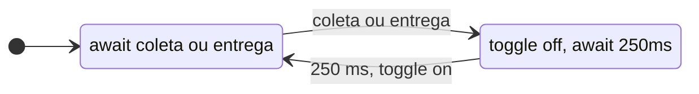

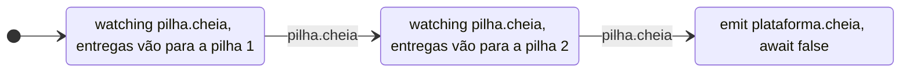

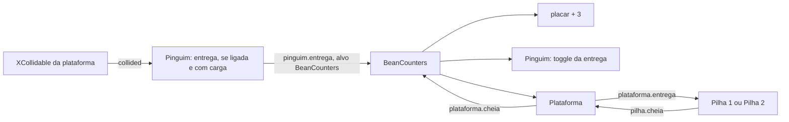

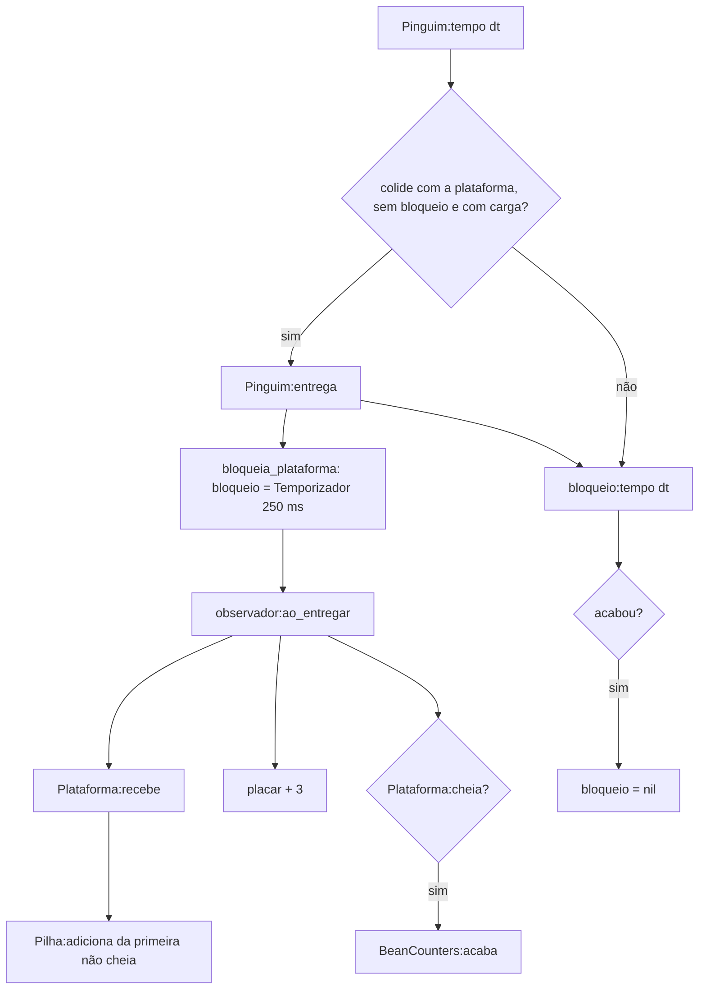

### 3.4 Praça: ir até um prédio

- Atmos: `screens/centro/pinguim.atm:28-77`; o destino chega pelo
  `:clicked` dos prédios (`predio.atm`), a chegada pelo `:collided`.
- Lua: `centro.lua:63` (`evento`), `pinguim.lua:27` (`escolhe_destino`),
  `:62` (`evento`), `:32` (`tempo`). Estado: `ponto`, `vel`, `destino`.

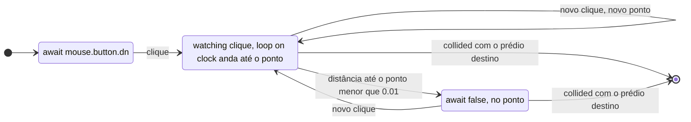

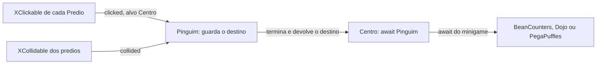

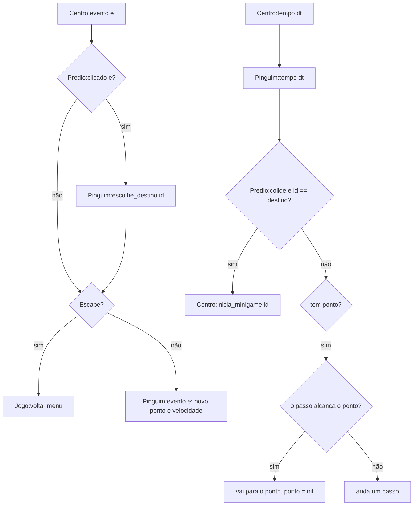

### 3.5 Botão com destaque

- Atmos: `util/components/botao.atm` (feito sobre `Predio`),
  `image_hover.atm`, `xclickable.atm`; o menu espera o primeiro botão
  clicado com `par :any` (`screens/telas_menu/menu.atm`).
- Lua: `util/botao.lua` (`em_cima`, `clicado`, `desenha`);
  `menu.lua` repassa o evento a cada botão.

```mermaid
stateDiagram-v2
    direction LR
    state "Botao: await clicked" as Espera
    [*] --> Espera
    Espera --> [*] : clicked, devolve o id
```

```mermaid
flowchart LR
    IH["Image_Hover: loop on draw escolhe a imagem pelo mouse"]
    XK["XClickable, alvo = o Botao"] -- "clicked" --> BO["Botao"]
    BO -- "termina com o id" --> ME["Menu: par any dos três botões"]
    ME -- "termina com o id" --> MA["main: Centro, Personalizar ou fim"]
    PR["Predio"] --> IH
    PR --> XK
    BO --> PR
```

```mermaid
flowchart TD
    EV["Menu:evento e"] --> CL["Botao:clicado e, para cada botão"]
    CL -- "o primeiro clicado" --> ME["Jogo:menu_escolheu id"]
    DE["Menu:desenha"] --> BD["Botao:desenha"]
    BD --> EC["Botao:em_cima: mouse sobre o retângulo?"]
```

## 4. Continuation Passing (Pingus)

O fim de uma atividade longa leva a uma continuação. No Pingus, isso cobre a
troca de telas e o fim de fases. Aqui: o fim de um minigame volta à praça
com as moedas; o menu leva à praça ou à personalização, que voltam ao menu.

- Atmos: `screens/centro/centro.atm:37-50` e `main.atm:18-25`. A
  continuação é a linha seguinte ao `await`.
- Lua: `centro.lua:43-51` (`inicia_minigame`, `termina_minigame`) e
  `jogo.lua:19-36` (`menu_escolheu`, `volta_menu`). A continuação é um
  método chamado quando o valor volta.

```mermaid
stateDiagram-v2
    direction LR
    state "await Pinguim" as Praca
    state "await do minigame" as Jogando
    [*] --> Praca
    Praca --> Jogando : chegou ao prédio
    Jogando --> Praca : moedas = moedas + resultado
    Praca --> [*] : Escape, pelo watching
    Jogando --> [*] : Escape, aborta o minigame
```

```mermaid
flowchart TD
    CT["Centro:tempo dt"] --> MT["minigame:tempo dt"]
    MT --> RV{"devolveu moedas?"}
    RV -- sim --> TM["Centro:termina_minigame"]
    TM --> GM["Jogo:ganha_moedas"]
    TM --> NP["Centro:novo_pinguim"]
    MN["Menu:evento"] --> JE["Jogo:menu_escolheu"]
    JE --> NT["Jogo.tela = Centro ou Personalizacao"]
    VO["Escape ou Voltar"] --> VM["Jogo:volta_menu"]
    VM --> NM["Jogo.tela = Menu"]
```

## 5. Lifespan Hierarchies (Pingus)

Quando o contêiner termina, os filhos terminam juntos. No Atmos isso vem da
estrutura; no Lua, de código que zera referências e remove mortos.

- Atmos: o minigame é filho do `watching` de Escape do `Centro`
  (`centro.atm:37`): Escape aborta a caminhada ou o minigame inteiro, com as
  cargas e o pinguim. As cartas (`carta.atm:30`, `watching 2s`) e as cargas
  (`carga.atm:63`, `await until`) terminam sozinhas e saem da pool.
- Lua: `viva = false` e `lista.tira_mortos` (`util/lista.lua:6`), chamado em
  `dojo.lua` e `bean_counters.lua`; `self.minigame = nil` em
  `centro.lua:37`; `Jogo:volta_menu` troca a tela, e a antiga fica sem
  referência.

**Armadilha encontrada (anotar no texto).** A pool `predios` é criada no
corpo do `Centro` (`centro.atm:17`), fora do laço, e o minigame roda num
`await` dentro desse laço. Como o `Centro` continua vivo, os prédios também
continuam: desenham por baixo do minigame e emitem `:clicked` para a árvore do
`Centro`, onde está o Dojo. Um clique onde fica um prédio chegava ao Dojo
como carta; hoje há um filtro (`dojo.atm:34`). A correção pelo escopo seria
criar os prédios num bloco `do { pin predios = tasks(3) ... await Pinguim(...) }`
dentro do laço, para morrerem quando o pinguim chega. No Lua, o mesmo cuidado
é manual: `centro.lua:63` só repassa o clique se houver pinguim.

```mermaid
flowchart TD
    CE["Centro"] --> PR["pool predios"]
    CE --> WE["watching Escape"]
    WE --> MG["minigame"]
    MG --> PO["pools e tasks do minigame"]
    PO --> FI["filhos: XCollidable, laços, imagens"]
    ES(["Escape"]) -. "aborta tudo abaixo do watching" .-> WE
```

```mermaid
flowchart TD
    TE["BeanCounters:tempo"] --> CA["Carga:tempo: passou do chão? viva = false"]
    CA --> T1["lista.tira_mortos cargas"]
    T1 --> PG["Pinguim:tempo: pegou a carga? Carga:some"]
    PG --> T2["lista.tira_mortos cargas"]
```

## 6. Signaling Mechanisms (Pingus) e Observer (Nystrom)

Entidades sem relação de hierarquia precisam se avisar. Nystrom descreve o
Observer; o Pingus mostra eventos internos de Céu no lugar de sinais do
Boost.

- Atmos: `emit @(jogo) :pinguim.coleta`, `:pinguim.entrega`,
  `:pinguim.atordoado` (`bean_counters/pinguim.atm:31,50,65`);
  `:pilha.cheia` → `:plataforma.cheia` (`pilha.atm:16`,
  `plataforma.atm:30`); `:clicked` e `:collided` dos componentes. Quem quer
  ouvir só escreve um `await` ou `loop on`; quem emite não conhece os
  ouvintes.
- Lua: o `Pinguim` recebe um observador no construtor e chama
  `ao_coletar`, `ao_entregar` e `ao_ser_atingido`
  (`bean_counters/pinguim.lua:24`, `bean_counters.lua:35-48`). O emissor
  conhece a interface do observador; cada novo ouvinte exige mudar o
  observador.

```mermaid
flowchart LR
    PG["Pinguim"] -- "pinguim.coleta" --> PL1["placar + 2"]
    PG -- "pinguim.coleta" --> TG["toggle da entrega"]
    PG -- "pinguim.entrega" --> PL2["placar + 3"]
    PG -- "pinguim.entrega" --> TG
    PG -- "pinguim.entrega" --> PF["Plataforma"]
    PG -- "pinguim.atordoado" --> LA["lançador"]
    PG -- "pinguim.atordoado" --> MV["movimento do Pinguim"]
    PG -- "pinguim.atordoado" --> FM["fim do jogo: vidas"]
```

```mermaid
flowchart LR
    PG["Pinguim"] -- "ao_coletar" --> BC["BeanCounters, o observador"]
    PG -- "ao_entregar" --> BC
    PG -- "ao_ser_atingido" --> BC
    BC --> PL["placar"]
    BC --> PF["Plataforma:recebe"]
    BC --> LA["lancamento = Temporizador 2 s"]
    BC --> AC["acaba"]
```

## 7. Component (Nystrom)

Comportamentos reutilizáveis presos a uma entidade, em vez de herança.

- Atmos: `Image`, `Image_Hover`, `XClickable`, `XCollidable`
  (`util/components/`) são tasks filhas que dão a uma entidade um
  comportamento. `Predio` = `Image_Hover` + `XClickable`; `Botao` = `Predio`
  + `await :clicked`; `Carta` do jogador ganha um `XClickable`; os pinguins
  ganham `XCollidable`.
- Lua: herança. `Predio` estende `Botao` (`screens/centro/predio.lua`), que
  estende `Objeto`. A colisão é um método (`Predio:colide`), não um
  componente.

```mermaid
flowchart TD
    BO["Botao"] --> PR["Predio"]
    PR --> IH["Image_Hover"]
    PR --> XK["XClickable"]
    CA["Carta do jogador"] --> XK2["XClickable"]
    CA --> IM["Image"]
    PC["Pinguim da praça"] --> XC["XCollidable dos predios"]
    PB["Pinguim do Bean Counters"] --> XC2["XCollidable das cargas"]
    PB --> XC3["XCollidable da plataforma"]
```

```mermaid
flowchart TD
    OB["Objeto: extend, new, init, tempo, evento, desenha"] --> BT["Botao: em_cima, clicado, desenha"]
    BT --> PD["Predio: colide"]
    OB --> PI["Pinguim, Carga, Carta, Puffle, telas"]
```

## 8. Subclass Sandbox (Nystrom)

A classe base dá às subclasses um conjunto de operações e ganchos; cada
subclasse só preenche o que precisa. No Lua, `Objeto` (`util/objeto.lua`)
define `extend`/`new`/`init` e os ganchos vazios `tempo`, `evento` e
`desenha`, que o laço chama em toda tela e entidade (diagrama da seção 7).
No Atmos não há equivalente: cada task é uma unidade com o próprio fluxo.

## 9. Type Object (Nystrom)

Os tipos são dados, não classes: um novo tipo de carga ou de carta é uma
linha na tabela.

- Lua: `TIPOS` (`bean_counters/carga.lua:6`), `IMG_ATINGIDO`
  (`bean_counters/pinguim.lua:15`), `BARALHO` (`dojo/dojo.lua:12`).
- Atmos: `tipos` (`bean_counters/carga.atm:1`), `cartas` e `VENCE`
  (`dojo/dojo.atm:6,14`).

```mermaid
flowchart LR
    TB["BARALHO: elemento, poder, imagem"] --> C1["Carta FOGO 4"]
    TB --> C2["Carta FOGO 7"]
    TB --> C3["Carta GELO 5"]
    TB --> C4["Carta GELO 6"]
    VE["VENCE: GELO vence AGUA, AGUA vence FOGO, FOGO vence GELO"] --> CO["comparação das cartas"]
```

## 10. Flyweight (Nystrom)

Os dados pesados (a textura) são compartilhados; cada instância guarda só o
que é seu (posição). O pico-sdl guarda um layer por caminho de imagem, criado
uma vez por partida (`bean_counters.lua:20-24`, `bean_counters.atm`); todas
as cargas do mesmo tipo usam o mesmo layer. Bom ponto para o texto: o giro do
café é um efeito do layer, então é compartilhado também, e cada carga
precisa ajustá-lo antes de se desenhar (`carga.lua:63`, `carga.atm:51`); as
pilhas o zeram (`pilha.lua:22`, `pilha.atm`).

```mermaid
flowchart LR
    L["layer Coffe_bag.webp: textura e giro"] --- C1["Carga 1: posição"]
    L --- C2["Carga 2: posição"]
    L --- P["Pilhas: posições, giro 0"]
```

## 11. Object Pool (relacionado)

Nystrom descreve o Object Pool como reaproveitamento de memória. O `tasks(n)`
do Atmos não reaproveita memória, mas tem duas coisas do padrão: o limite de
tamanho (`tasks(3)` para os prédios e as cartas, `tasks(#path_puffles)` para
os puffles) e a gestão do ciclo de vida (a task que termina sai da pool). No
Lua, as listas `cargas` e `puffles` fazem o papel, com remoção explícita.
Melhor citar como "relacionado", não como o padrão.

## 12. Observações para o texto

- Em cada linha da tabela 6.3, a coluna Atmos tem um diagrama de estados que
  é o próprio código lido de cima para baixo; a coluna Lua tem o estado em
  campos e o fluxo espalhado entre `evento` e `tempo`. É a tese do Pingus
  ("variáveis com nomes suspeitos" como `tonto`, `bloqueio`, `espera`).
- O preço do Atmos aparece nos diagramas de comunicação: quem recebe um
  evento depende do alcance do `emit`. Dois erros reais vieram disso (o
  `:clicked` dos prédios chegando ao Dojo; o `until` que encerrava o laço de
  colisões). O `emit` por referência (`emit @(jogo)`, `XClickable(alvo, me)`)
  reduziu o risco. Resta um `emit @2` em `pega_puffles/puffle.atm:69`.
- O preço do Lua aparece nos diagramas de fluxo: a ordem das chamadas dentro
  do quadro é semântica, e os prazos criados num passo só podem contar no
  seguinte. No Atmos isso vem do escalonador.
